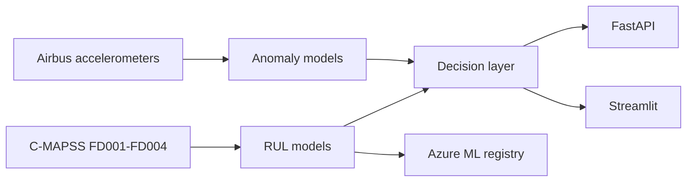

# Rotorcraft predictive maintenance (proof of concept)

A public-data system that estimates how many cycles a turboshaft-style engine has left, flags abnormal helicopter vibration, and turns those numbers into a maintenance suggestion for a fictional fleet of 12 aircraft.

**This project is not affiliated with the U.S. Army, Boeing, or Airbus.** It does not use military, controlled, or classified data. It is not an airworthiness authority. The tail numbers `POC-01` to `POC-12` are made up.

## The problem

Attack helicopters fly with a health and usage monitoring system. The idea is simple: do not wait for a fixed calendar if the machine is telling you it is getting worse, and do not ignore it because the calendar says it is fine. A late "you are fine" call is more dangerous than an early "come in for inspection."

No public dataset is an AH-64. This project uses two public proxies and says, in [DATA_SOURCES.md](DATA_SOURCES.md), where each proxy stops being a fair stand-in.

## How the pieces connect

```
  NASA C-MAPSS zip                         Airbus accelerometer HDF5
  (turbofan run-to-failure)                (helicopter vibration, CC BY-NC-SA)
           |                                          |
           v                                          v
  data/cmapss.py                              data/vibration.py
  RUL label, cap at 125                       1-second windows
  drop constant sensors                       FFT bands, kurtosis, crest factor
           |                                          |
           v                                          v
  linear / forest / LightGBM / XGBoost        isolation forest, one-class SVM
  LSTM and 1D CNN                             autoencoder reconstruction error
           |                                          |
           +------------------+-----------------------+
                              v
                    lower confidence bound
                              |
                              v
                    inspect / schedule / ground
                              |
                              v
              FastAPI  +  Streamlit fleet screen
```



## Results

The numbers in [reports/results.md](reports/results.md) are written by `scripts/train.py`. If that file is missing, the training run has not been committed yet. The NASA score is the selection metric. It penalizes late remaining-life calls more than early ones. See [EVALUATION.md](EVALUATION.md).

## Run it

PowerShell, from this folder:

```powershell
python -m venv venv
.\venv\Scripts\Activate.ps1
pip install -e ".[dev]"
python scripts/download_data.py
python scripts/train.py
pytest
streamlit run src/rotorcraft_pdm/dashboard/app.py
uvicorn rotorcraft_pdm.api.app:app --host 127.0.0.1 --port 8000
```

Docker:

```powershell
docker compose up --build
```

The API is at `http://127.0.0.1:8000`. The dashboard is at `http://127.0.0.1:8501`.

## Azure

Resource group: `rg-rotorcraft-pdm`. Infrastructure: [infra/main.bicep](infra/main.bicep).

This subscription disables public network access on storage accounts and will not turn it back on. A laptop often cannot upload a model file. [RUNBOOK.md](RUNBOOK.md) and [COSTS.md](COSTS.md) describe what was created and how to redeploy without leaving an always-on machine running.

## Read these before you claim the work

| File | Why |
| --- | --- |
| [DECISIONS.md](DECISIONS.md) | What was chosen, and the option that was rejected |
| [DATA_SOURCES.md](DATA_SOURCES.md) | Licenses and the turboshaft proxy argument |
| [EVALUATION.md](EVALUATION.md) | Metrics, false negatives, limitations |
| [LEARNING_GUIDE.md](LEARNING_GUIDE.md) | Questions to answer out loud |

## License

Code in this repository is released for learning. Results derived from the Airbus accelerometer files stay under [CC BY-NC-SA 4.0](https://creativecommons.org/licenses/by-nc-sa/4.0/). Do not use those results commercially. NASA C-MAPSS is a U.S. Government work; cite Saxena, Goebel, Simon, and Eklund (2008).
